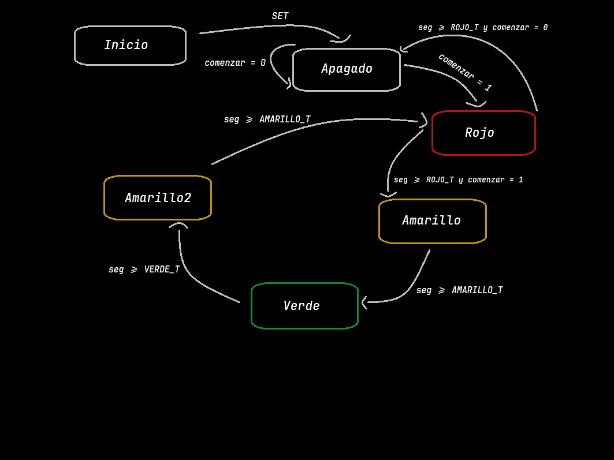

# Informatica2_TPIntegrador
Programa que utiliza un microcontrolador ATMEGA128 para el funcionamiento de un semáforo. En este repositorio se encuentran los archivos para el correcto funcionamiento del microcontrolador como también los archivos necesarios para simular el circuito en el programa Proteus.
El circuito está diseñado para iniciar el semáforo cuando se pulse una tecla y mientras esta pulsada siga su funcionamiento. Al dejar de pulsar, el semáforo dejara de funcionar al terminar la última secuencia de encendido.

